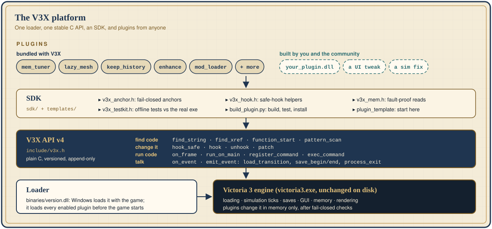
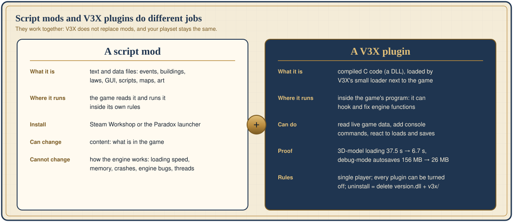
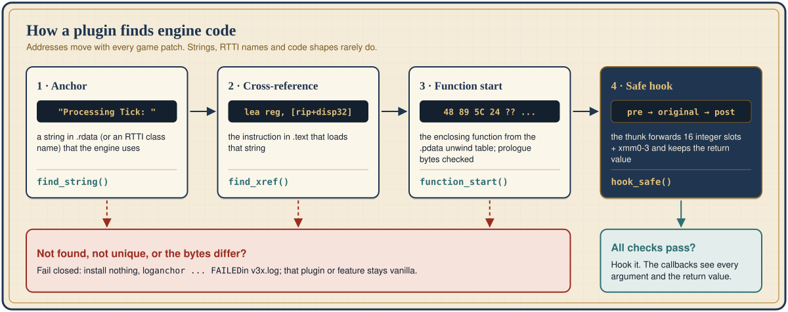
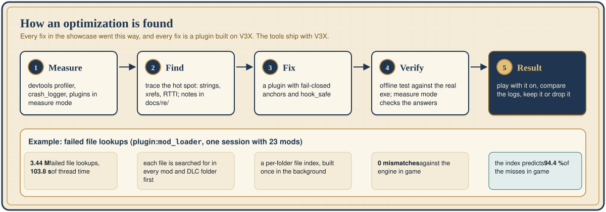
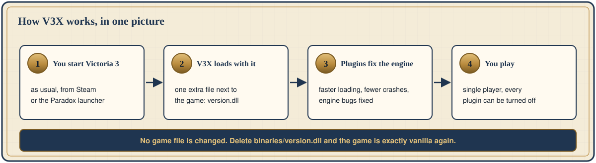
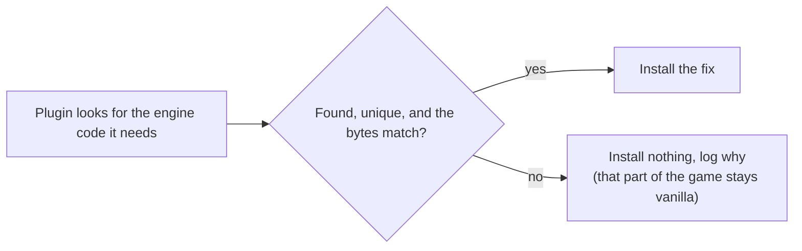
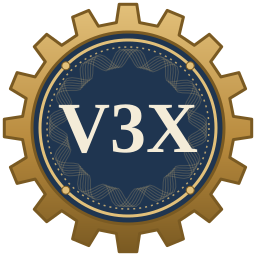

<p align="center">
  
</p>

<p align="center">
  
  
  
  
  
  
  
</p>

**V3X (Victoria 3 eXtender) is a modding platform for Victoria 3 that works at the level of the game engine.** It is a
native loader, a stable plugin API and an SDK. With them you write mods in C that run *inside the
game's program*, so they can change Victoria 3 far more deeply than script mods can: hook engine
functions safely, read live game data, add console commands, react to loads and saves, and ship
it all as a plugin that players turn on or off from the main menu.

V3X comes with 31 plugins built this way. They are the proof that it works: 3D models
load in 6.7 s instead of 37.5 s, debug-mode autosaves shrink from 156 MB to 26 MB, and the GDP
history graphs no longer get wiped ([showcase](#what-we-built-with-v3x)).

<p align="center">
  
</p>

## What you can build

| | |
|---|---|
|  **Hook engine functions safely** | `hook_safe` runs your `pre` / `post` callbacks around any engine function. It forwards every argument and the return value, so you cannot get the argument count wrong. |
|  **Find engine code that survives patches** | look code up by strings, RTTI class names and byte patterns, not addresses. If something no longer matches, the plugin installs nothing and logs why. |
|  **Read live game data** | fault-proof memory reads (`sdk/v3x_mem.h`) and RTTI lookups (`include/v3x_rtti.h`). `console_plus` reads the game's databases to Tab-complete country tags, states and laws. |
|  **Add console commands** | `register_command` adds commands to the V3X console window. `exec_command` / `exec_capture` run commands and read their output. |
|  **React to game events** | subscribe to `load_transition` (menu to game and back), `save_begin` / `save_end` and `process_exit`, or emit your own events for other plugins. |
|  **Ship it to players** | one DLL with a manifest (name, version, supported game builds) and an optional ini. Players switch it on or off in `v3x.ini` or from the main-menu **V3X** button. |

## Script mods vs. V3X plugins

Normal Victoria 3 mods are **text and data**: events, buildings, laws, GUI files, scripts. The game
reads them and runs them by its own rules, so they can change *what is in the game*. They cannot
change *how the engine works*: how fast it loads, how it uses memory, why it crashes, bugs in its
code, or how it uses your CPU.

A V3X plugin is **compiled code that runs inside the engine**, so it can do exactly those things. It
does not replace mods: both work together, and a player's playset stays the same.

<p align="center">
  
</p>

| | Script mod | V3X plugin |
|---|---|---|
| Made of | text and data files (events, buildings, GUI, scripts) | compiled code: an x64 DLL, usually written in C |
| Runs | inside the game's script and GUI systems | inside the game's program, next to the engine code |
| Can change | content: what is in the game | the engine: loading, memory, saves, crashes, threads, engine bugs |
| Can read | what script and GUI expose | live engine data (with fault-proof reads) |
| Works with the other? | yes | yes: V3X does not touch the mod list |
| Distributed via | Steam Workshop / Paradox launcher | a DLL in `binaries/v3x/plugins/` |
| Multiplayer | yes | **no, single player only** |

## For modders

### Quick start

You need Windows x64, Python and Git Bash. The compiler is zig from pip, so no Visual Studio.

```sh
cd "<Steam>/steamapps/common/Victoria 3"
git clone --recursive https://github.com/kleeedolinux/v3x.git && cd v3x
pip install ziglang && ./build.sh install                                # loader + bundled plugins into ../binaries
python sdk/build_plugin.py templates/plugin_template --test ../binaries/victoria3.exe   # your first plugin, tested offline
```

Copy [`templates/plugin_template/`](templates/plugin_template/), rename it, then build, test and
install it with `python sdk/build_plugin.py <dir> --test --install`. Walkthrough (about 10 minutes):
[docs/getting-started.md](docs/getting-started.md).

### A complete plugin

This plugin counts game ticks. The file builds without warnings, and the offline test finds its
anchor in the 1.15.1 exe.

```c
#include <windows.h>
#include "v3x.h"

V3X_PLUGIN_MANIFEST("tick_counter", "0.1.0", "you", "counts game ticks", "release/1.15*");
static volatile LONG g_ticks;

static void on_tick(V3X_HookCall *call) { (void)call; InterlockedIncrement(&g_ticks); }

V3X_EXPORT int v3x_plugin_load(const V3X_API *api)
{
    if (!V3X_HAS(api, hook_safe)) return 1;                 /* loader older than API v4 */
    void *s  = api->find_string("Processing Tick: ");      /* 1. anchor: a log string */
    void *x  = s ? api->find_xref(s, 0) : NULL;            /* 2. the code that loads it */
    void *fn = x ? api->function_start(x) : NULL;          /* 3. its function (.pdata) */
    if (!fn) { api->log("tick_counter", "anchor FAILED: nothing installed"); return 1; }
    return api->hook_safe(fn, on_tick, NULL, NULL);        /* 4. observe; args forwarded */
}
```

<p align="center">
  
</p>

### The API at a glance

[`include/v3x.h`](include/v3x.h) is plain C, versioned and append-only. Check for newer fields with
`V3X_HAS(api, field)`.

| you want to | use |
|---|---|
| find engine code | `find_string`, `find_xref`, `function_start`, `pattern_scan`; anchor tables in [`sdk/v3x_anchor.h`](sdk/v3x_anchor.h) |
| change it | `hook_safe` (pre/post, all 16 integer argument slots, `xmm0`-`xmm3`, return value), `hook`, `unhook`, `patch` |
| run code on the main thread | `on_frame` (every frame), `run_on_main` (once) |
| talk to the player or other tools | `log`, `register_command`, `print`, `exec_command`, `exec_capture` |
| react to the game | `on_event` / `emit_event`: `load_transition`, `load_transition_begin`, `save_begin`, `save_end`, `process_exit` |
| identify the game | `game_version`, `game_build_id`, manifest `supported game builds` |
| test without the game | [`sdk/v3x_testkit.h`](sdk/v3x_testkit.h): map the real `victoria3.exe` and check your anchors offline |

<p align="center">
  
</p>

Read next: [API reference](docs/api-reference.md) · [safety rules](docs/safety.md) (each one
learned from a crash) · [reverse-engineering guide](docs/reverse-engineering.md) ·
[engine map](docs/engine-map.md) · [console commands and events](docs/console-commands.md) ·
[building and testing](docs/testing.md).

## What we built with V3X

The bundled plugins are real engine work done with this SDK. Each fix below went the same way:
measure with V3X's own tools, find the cause in the engine, fix it in a plugin, check it offline
against the real exe, then measure again in the game.

<p align="center">
  
</p>

<p align="center">
  
</p>

<sub>All numbers were measured on the author's PC (16 GB RAM, integrated GPU, Victoria 3 1.15.1).
Yours will differ.</sub>

**3D models loaded on demand** (`lazy_mesh`). *Measured:* the loading screen spends 37.5 s in one
pass over all 2,118 3D-model types, used or not. *Found:* the pass calls one load function per type,
and every later use goes through a few choke points. *Fixed:* `lazy` mode loads the types a game
really uses and defers the rest to their first use. *Result:* the pass took **6.7 s** in a 4-hour
session, with 531 deferred loads (28.4 s in total) spread over the game. It is opt-in.
[Story](docs/re/lazy_mesh.md)

**Failed file lookups and slow textures** (`mod_loader`). *Measured:* in one session with 23 mods,
the engine made **3.44 M failed file lookups, costing 103.8 s of thread time**. One 9.5 s stall on
the main menu was 704 texture files at 12.9 ms each. *Found:* every file is searched for in each
mod and DLC folder before the base game, one Windows call per folder. *Fixed:* a per-folder file
index, built once in the background, that predicts those misses. *Result:* in game it predicted
**94.4 %** of the misses with **0 mismatches** against the engine (99.90 % in an offline replay
after a coverage fix). With `mode=on` it now skips the predicted misses: in a 1 h 44 m session it
did so with **0 mismatches** and 98,786 re-checked skips, and the remaining misses cost 1.43 s in
the whole session ([session report](docs/sessions/2026-11-13-evening.md)). It is not shipped to
players yet (default `mode=measure`).
[Story](docs/re/modloading.md) · [textures](docs/re/lazy_gfx.md)

**GDP history wiped on a country switch** (`keep_history`). *Found:* when you stop playing a
country, the engine clears its GDP, population and other graphs, and AI countries record only every
120 days. *Fixed:* the 11 calls that clear the graphs are disabled, and every country records like a
player country (every 28 days by default). *Result:* confirmed in game: a country you played keeps
its graphs after you switch. [Story](docs/re/history.md)

**156 MB debug-mode autosaves** (`enhance`). *Measured:* with `debug_mode` every autosave was
156 MB of uncompressed text. *Found:* three save paths switch to the text format whenever the debug
flag is set. *Fixed:* those three checks are patched, so saves use the normal compressed format.
*Result:* **26 MB** per save. The ~3.2 s save pause stays: it is spent serializing, not writing.
[Story](docs/re/enhance.md)

**One lock in the save writer** (`fast_lookup`). *Measured:* sampling all threads over a 4-hour
game put **8.0 % of all game-code samples** in a single global spin lock that guards the token
registry, taken for every token while a save is written. *Fixed:* a lock-free side cache that gives
bit-identical answers (`measure` mode checks every answer against the engine). *Result, offline
benchmark on the real engine code:* with 8 threads a lookup costs **14.4-14.7 ns instead of
50-51 ns**. [Story](docs/re/datastructures.md)

**The New Game crash** (`mem_tuner`). *Measured:* five crash dumps all showed Windows' commit memory
used up (5-20 MB left) while 0.6-3.9 GB of RAM was still free. *Found:* no game code catches
out-of-memory, and the engine's allocator commits memory eagerly. *Fixed:* `mem_tuner` lowers the
allocator's commit, returns free memory after loads, keeps a 128 MB emergency reserve, and logs a
clear message pointing to the pagefile. *Result:* with a bigger pagefile the game loads, and the
author played a 4-hour session. [Story](docs/re/memory.md)

Also bundled: a crash log with C++ error types and stacks (`crash_logger`), the console in ironman
(`ironman_console`), a frame cap that sleeps instead of running a core at 100 % (`frame_pacer`),
P-/E-core thread placement on hybrid CPUs (`cpu_sched`), quieter engine logs (`log_filter`), file
overrides without a mod (`content_packs`), and modder tools: a sampling profiler (`devtools`), a
disassembler console (`devconsole`), per-task tick timing (`tick_profiler`), allocation tracking
(`alloc_tracker`) and an MCP bridge (`devbridge`), plus `script_ext`, which lets a plugin ship game
script, localization and GUI files ([docs/scripting.md](docs/scripting.md)).

| class | plugins |
|---|---|
| on in the player installer | crash_logger, content_packs, mod_menu, keep_history, ironman_console, log_filter, frame_pacer, cpu_sched, gfx_driver, mem_tuner, fast_load, script_ext |
| shipped, off (opt-in) | console_plus, loc_fallback, enhance, asset_stream, lazy_mesh, sim_opt |
| measure-only (not shipped) | fast_lookup, mod_loader, map_cache, lazy_gfx, par_load, tick_par, ai_par |
| developer tools (not shipped) | alloc_tracker, devtools, devconsole, devbridge, tick_profiler, hello |
| SDK service (shipped on, hooks nothing) | script_ext |

Status, defaults, crash history and tests of each: [docs/plugins.md](docs/plugins.md).

**In progress:** in a 1 h 44 m session (2026-11-13) `mod_loader mode=on` skipped 98,786 file
misses with 0 mismatches, and `fast_lookup` checked 1.7 M answers in `measure` with 0 mismatches,
so it can be switched on ([session report](docs/sessions/2026-11-13-evening.md)). Texture prefetch
and the decoded-image cache (`lazy_gfx`), parallel game init (`par_load`), AI tick analysis
(`ai_par`) and `script_ext` are tested offline only; `loc_fallback`, `mod_menu` and `console_plus`
loaded in that session, but their features were not checked in game.

## For players

<p align="center">
  
</p>

### Install in 3 steps

> **No release has been published yet.** Until then, get `V3X-Setup.exe` from whoever sent it to
> you, build it yourself with `python installer/make_dist.py` (output `build/dist/V3X-Setup.exe`), or
> use the [quick start](#quick-start) above (`./build.sh install`).

1. **Download** `V3X-Setup.exe` from the [Releases page](https://github.com/kleeedolinux/v3x/releases).
2. **Close Victoria 3 and run it.** It finds the game through Steam (or asks for the folder), shows
   the game version, and installs `binaries\version.dll` and `binaries\v3x\`. No admin rights, no
   game file changed.
3. **Start the game** as usual. A "V3X console" window opens next to it and shows what loaded.

Details, checksums and the silent mode for scripts: [docs/install.md](docs/install.md).

**Turn plugins on or off** from the main-menu **V3X** button, or in `binaries/v3x/v3x.ini`:

```ini
[plugins]
lazy_mesh = 1
alloc_tracker = 0
```

`0` means "do not load", a missing line means "load". Changes apply at the next start. To hide the
console window, add `console=0`. All options: [docs/configuration.md](docs/configuration.md).

**Repair, update, uninstall:** run `V3X-Setup.exe` again. Without it, delete `binaries/version.dll`
and the `binaries/v3x/` folder ([docs/install.md](docs/install.md)).

<p align="center">
  
  
</p>
<p align="center"><sub>Illustrations of the console window and the plugin menu, not screenshots. Real screenshots: TODO.</sub></p>

### Is it safe?

* **No game file is changed.** V3X is one extra file next to the game, and Steam's "Verify
  integrity" leaves it alone. Delete `binaries/version.dll` and you have the unmodded game again.
* **Every plugin can be turned off**, one by one.
* **Single player only.** V3X is not part of the multiplayer checksum, so do not use it online.
  `ironman_console` keeps the console blocked in multiplayer.
* **It unlocks nothing.** No plugin touches DLC ownership or achievement code.
* **It refuses rather than guesses.** After a game update, a plugin whose engine code changed does
  nothing and says so in `binaries/v3x/v3x.log`:



Plugins that change the simulation are off by default. Back up your saves before you try them.

### Troubleshooting

* **The game does not start or crashes right away:** rename `binaries/version.dll`. If the game
  then works, turn plugins off one by one in `v3x.ini` to find the cause.
* **Logs:** `binaries/v3x/v3x.log`, `crash.log`, `crash.prev.log`. Copy them before you restart,
  because the next start overwrites them. If you find `v3x.<number>.log` instead, Paradox's
  CrashReporter was holding `v3x.log` open after a crash.
* **Out of memory on New Game:** if `v3x.log` says `Windows commit limit is exhausted`, make the
  Windows pagefile bigger (system-managed or 16 GB+). [Background](docs/re/memory.md).
* **Low disk space on C::** the pagefile grows on its drive, and an autosave failed with
  `Failed to write to disk` when C: was nearly full. Keep several GB free.

More: [docs/troubleshooting.md](docs/troubleshooting.md).

### FAQ

**Multiplayer?** No. V3X is a single-player tool.

**Ironman and achievements?** V3X does not touch achievement code or DLC ownership. But
`ironman_console` (on by default) makes the console usable in ironman, and some opt-in plugins
change the simulation. If achievements matter to you, set `ironman_console = 0` and leave the
simulation options off.

**My Workshop mods?** They keep working. A mod that replaces the main-menu file hides the V3X
button, but `v3x.ini` still works.

**Game update?** Plugins whose engine code changed switch themselves off until they are updated.
V3X targets **1.15.1**.

**Antivirus warning?** V3X uses the common "DLL next to the exe" technique, which some antivirus
programs flag on principle. All the source is here, and you can build it yourself.

**Linux / Proton?** Untested. It may need `WINEDLLOVERRIDES="version=n,b"`.

More: [docs/faq.md](docs/faq.md).

## How the loader works

`victoria3.exe` imports `VERSION.dll`, which is not a Windows "KnownDLL", so Windows loads the copy
in the game folder first. V3X's `version.dll` forwards all 17 real functions to
`System32\version.dll` ([src/proxy.c](src/proxy.c)) and hooks the game's entry point. There, before
the game's own startup code runs, it loads every enabled plugin ([src/core.c](src/core.c)).

<p align="center">
  
</p>

## Roadmap

* The first release (`V3X-Setup.exe`) on GitHub Releases, and real screenshots.
* Bring the in-progress items above into the game and publish their numbers.
* Keep the bundled plugins working on new game versions (anchor updates).
* Choose a license.

## Documentation

[Docs index](docs/README.md) · [Getting started](docs/getting-started.md) ·
[API reference](docs/api-reference.md) · [Safety rules](docs/safety.md) ·
[Configuration](docs/configuration.md) · [Console commands and events](docs/console-commands.md) ·
[Plugin catalog](docs/plugins.md) · [Building and testing](docs/testing.md) ·
[Installing (players)](docs/install.md) · [Script from plugins](docs/scripting.md) ·
[Maturity](docs/maturity.md) · [Session reports](docs/sessions/) ·
[Reverse engineering](docs/reverse-engineering.md) · [Engine map](docs/engine-map.md) ·
[Troubleshooting](docs/troubleshooting.md) · [FAQ](docs/faq.md) · [RE notes](docs/re/)

## Contributing, license, credits

* **Contributing:** read [CONTRIBUTING.md](CONTRIBUTING.md) and [docs/safety.md](docs/safety.md)
  first. Changes are listed in [CHANGELOG.md](CHANGELOG.md).
* **License: not chosen yet.** Until the project lead picks one, no license is granted (all rights
  reserved by the authors). See [LICENSE](LICENSE).
* **Credits:** [MinHook](https://github.com/TsudaKageyu/minhook) (BSD 2-Clause) for inline hooks,
  [Zydis](https://github.com/zyantific/zydis) (MIT) for disassembly. Details:
  [third_party/NOTICES.md](third_party/NOTICES.md).
* Victoria 3 is a trademark of Paradox Interactive. V3X is an unofficial fan project and is not
  affiliated with or endorsed by Paradox Interactive.

<p align="center"></p>
