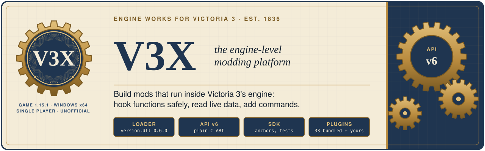
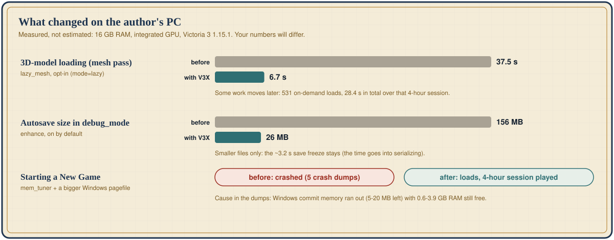
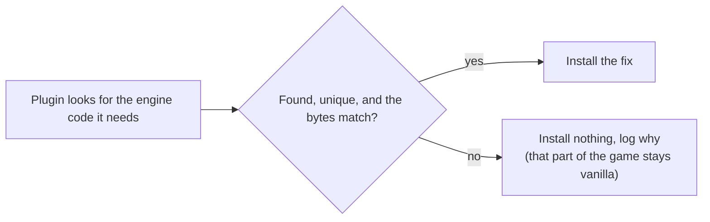
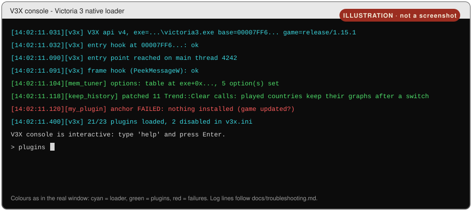
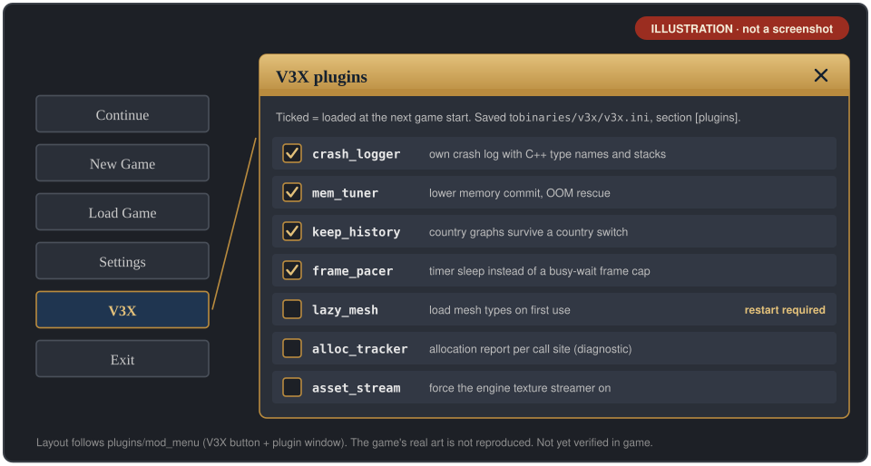
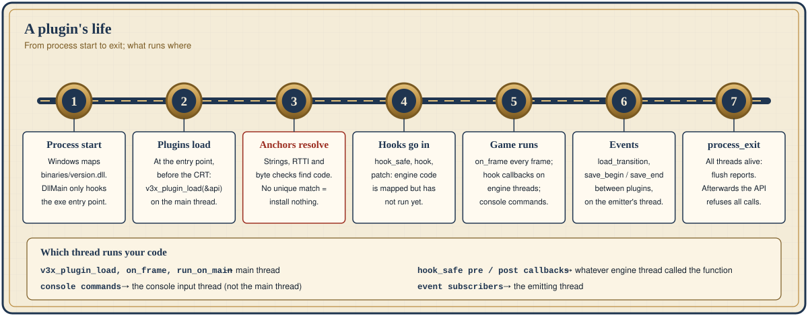
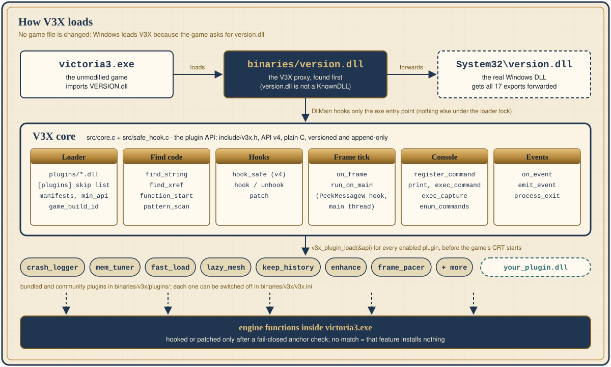

<p align="center">
  
</p>

<p align="center">
  
  
  
  
  
  
</p>

**V3X is a free add-on for Victoria 3. It starts together with the game and fixes and speeds up the
game engine itself: the part of the game that normal mods cannot reach.** It does not change any
game file, it works next to your normal mods, and you remove it by deleting one file.

<p align="center">
  
</p>

<sub>Real measurements from the author's PC (16 GB RAM, integrated GPU, Victoria 3 1.15.1), not
estimates. Your PC will give different numbers. Sources: [lazy_mesh](docs/re/lazy_mesh.md#7-first-in-game-session-1151-lead-4-h-modelazy-defaults-and-the-hitch-fixes),
[saves](docs/re/enhance.md#1-autosave-freeze), [New Game crash](docs/re/memory.md#3-leads-crash-what-the-dumps-show-d).</sub>

<p align="center">
  
</p>

## A normal mod vs. V3X

Think of Victoria 3 as a theatre. **Normal mods write new plays**: new events, buildings, laws,
interface screens, balance. The stage crew (the engine) performs whatever the script says, but
always with the same machinery. A mod can never touch that machinery.

**V3X works on the machinery itself.** It is a small program file (`version.dll`) that Windows loads
*into* the game's own process when it starts. From there its plugins can change how the engine
behaves, which no text file, script or Workshop mod can reach. It does not replace your mods: your
playset stays exactly as it is, and runs on a better engine.

### What V3X can do that a normal mod never can

Every row below is something V3X already does in the game, and something a script mod has no way to touch:

| The problem | Why a normal mod can't fix it | What V3X does |
|---|---|---|
| Loading takes minutes | Mods can't decide *how* or *when* the engine loads files | Loads 3D models only when they are first needed (model loading **37.5 s → 6.7 s** measured), and answers millions of "is this file in that mod folder?" lookups instantly from an index instead of asking the disk 40 times per file (new; gain being measured) |
| "New Game" crashes on a 16 GB PC | Memory is managed by the engine's allocator, invisible to scripts | Tunes the engine's memory allocator, returns unused memory, and adds an out-of-memory safety net that frees a reserve instead of crashing |
| Your old country's GDP graph is wiped when you switch countries | The wipe is hard-coded in the engine | Removes exactly those 11 engine "clear history" calls, and records history for every country |
| Autosaves in debug mode are huge | The save format is chosen by engine code | Keeps saves compressed (**156 MB → 26 MB** measured) |
| A crash tells you nothing | Mods can't see inside the program | Writes its own crash log: what failed, where in the engine, how much memory was left |
| Your CPU is half idle while loading | Threads and cores are engine internals | Puts the main thread on performance cores, stops idle worker threads from burning power in busy loops |
| You can't see what slows your game | No script can time engine code | Built-in profiler: which of the 272 simulation tasks and which engine functions take the time |
| The console is locked in ironman and has no help | Console rules are engine code | Console in ironman, Tab completion for countries, states and events, and an in-game V3X menu to switch plugins on and off |

### What stays the job of normal mods

New content (events, decisions, buildings, laws, maps, art, balance) is still best done with normal
mods. V3X doesn't add content by itself; it makes the engine run that content faster and more reliably.

**For modders:** V3X is also an SDK. You can write your own engine plugins in C: hook an engine
function safely, add console commands, react when the game loads or saves, and read live game
data. See [For modders](#for-modders).

<p align="center">
  
</p>

| | Normal mod | V3X |
|---|---|---|
| What it is | text and data files (events, buildings, GUI, scripts) | a native add-on: `version.dll` + a `v3x` folder next to the game exe |
| Installed from | Steam Workshop / Paradox launcher | a zip you unpack into the game's `binaries` folder |
| Can change | game content | the engine: loading, memory, crashes, engine bugs, threads |
| Together? | yes: V3X works with any playset | yes: it does not touch your mod list |
| Multiplayer | yes | **no, single player only** |
| Remove it | unsubscribe | delete `binaries/version.dll` and `binaries/v3x/` |

## What it does for you

<table>
<tr>
<td width="50%" valign="top">
<br>
<b>Loads 3D models faster (opt-in)</b><br>
The game loads all 2,118 kinds of 3D models at startup, used or not. With <code>lazy_mesh</code> in
<code>lazy</code> mode it loads only those it needs and the rest when first used: that part of loading
went from <b>37.5 s to 6.7 s</b>. Some of the work moves later (531 small loads in a 4-hour game),
which is why it is off by default for now.
</td>
<td width="50%" valign="top">
<br>
<b>Fewer out-of-memory crashes</b><br>
Five New Game crash dumps showed the same cause: Windows had run out of <i>commit</i> memory
(5-20 MB left) while 0.6-3.9 GB of RAM was still free. <code>mem_tuner</code> makes the game commit
less memory up front, returns free memory to Windows after loads, keeps a 128 MB emergency reserve and says
in the log when the pagefile is too small. With a bigger pagefile the author played a 4-hour session.
</td>
</tr>
<tr>
<td valign="top">
<br>
<b>History graphs you can trust</b><br>
In the unmodded game, the GDP, population and other graphs of a country are wiped when you stop
playing it, and AI countries record only every 120 days. <code>keep_history</code> keeps the graphs
(it disables the 11 places that wipe them) and records every country like a player country, every
28 days by default.
</td>
<td valign="top">
<br>
<b>Small saves in debug mode</b><br>
Playing with <code>debug_mode</code> makes the game write uncompressed text saves:
<b>156 MB</b> per autosave. <code>enhance</code> makes them normal compressed saves again:
<b>26 MB</b>. (The 3-second save pause stays; that time goes into preparing the save, not
writing it.)
</td>
</tr>
</table>

Also on by default: the developer console works in **ironman** (`ironman_console`), a readable
**crash log** with the real error and stack (`crash_logger`), a **frame cap that sleeps instead of
running a core at 100%** and lowers the frame rate when you are idle, paused or in another window
(`frame_pacer`), P-core / E-core placement of the game's threads on hybrid CPUs (`cpu_sched`)
and **quieter log files** (`log_filter`).

## Is it safe?

* **No game file is changed.** V3X is one extra file next to the game. Steam's "Verify integrity"
  leaves it alone, and deleting `binaries/version.dll` gives you the unmodded game back.
* **Every plugin can be turned off**, one by one, from the main menu or a text file (see below).
* **Single player only.** V3X is not part of the game's multiplayer checksum, so do not use it
  online. (`ironman_console` keeps the console blocked in multiplayer.)
* **It does not unlock anything.** No plugin touches DLC ownership or achievement code.
* **It refuses rather than guesses.** Every plugin checks that the engine code it wants to change
  looks exactly as expected. After a game update, a plugin that no longer matches does nothing and
  says so in `binaries/v3x/v3x.log`, instead of crashing:



Back up your saves before trying plugins that change the simulation (all of those are off by
default). The rules plugin authors follow: [docs/safety.md](docs/safety.md).

## Install in 3 steps

> **No release zip has been published yet.** Until the first release, use
> [Build from source](#build-from-source) below; the result is the same two items.

1. **Download** the latest V3X release zip from the [Releases page](https://github.com/kleeedolinux/v3x/releases).
2. **Unzip** it into the game's `binaries` folder, so that you get
   `...\steamapps\common\Victoria 3\binaries\version.dll` and `...\binaries\v3x\`.
   (In Steam: right-click Victoria 3 > Manage > Browse local files > `binaries`.)
3. **Start the game** as usual. A "V3X console" window opens next to it and shows what loaded.

**Turn plugins on or off:** main menu > **V3X** button (the `mod_menu` plugin; new and not yet
verified in game), or edit `binaries/v3x/v3x.ini`:

```ini
[plugins]
lazy_mesh = 1
alloc_tracker = 0
```

`name = 0` means "do not load this plugin", a missing line means "load it". Changes apply at the
next start. No console window: put `console=0` in the same file. All options:
[docs/configuration.md](docs/configuration.md).

**Uninstall:** delete `binaries/version.dll` and the `binaries/v3x/` folder. That's all.

### Build from source

Needs Windows, Python and Git Bash. The compiler is zig from pip (no Visual Studio).

```sh
cd "<Steam>/steamapps/common/Victoria 3"
git clone --recursive https://github.com/kleeedolinux/v3x.git
cd v3x && pip install ziglang && ./build.sh install    # copies version.dll + v3x/plugins into ../binaries
```

Details: [docs/getting-started.md](docs/getting-started.md).

## Screenshots

> **TODO:** real in-game screenshots are still missing. The two pictures below are drawings made
> for this README, clearly marked as illustrations; they show the layout, not the game's art.

<p align="center">
  
  
</p>

## Features

| | |
|---|---|
|  **Loading** | load timeline (`fast_load`), 3D models on demand (`lazy_mesh`), texture streaming forced on (`asset_stream`) |
|  **Stability** | memory tuning and OOM rescue (`mem_tuner`), crash log with C++ error types and stacks (`crash_logger`) |
|  **Engine fixes** | graphs kept on country switch (`keep_history`), compressed saves in debug mode (`enhance`) |
|  **CPU and GPU** | sleeping frame cap (`frame_pacer`), P/E-core scheduling (`cpu_sched`), fewer GPU-driver threads on integrated GPUs (`gfx_driver`) |
|  **Console** | console in ironman (`ironman_console`), the V3X console window with commands, Tab completion (`console_plus`) |
|  **Control** | V3X button on the main menu (`mod_menu`), `[plugins]` on/off list, file overrides without a mod (`content_packs`) |
|  **For modders** | C plugin API, safe hooks, anchors, offline tests against the real exe, profilers and a disassembler console |

## Plugin catalog

25 plugins ship with V3X. "In game" says how far each one has really been run in Victoria 3 1.15.1:
**4h** = played in a 4-hour session, **loads** = loaded in a short run without exercising its
features, **not yet** = never run in the game. All of them build and pass their offline tests.
Full catalog with console commands: [docs/plugins.md](docs/plugins.md).

| plugin | what it does | default | in game |
|---|---|---|---|
| **Players** | | | |
| `mem_tuner` | lower memory commit, free memory after loads, one OOM rescue | on | 4h (newer features: loads) |
| `keep_history` | country graphs survive a country switch; AI countries recorded like players | on | 4h |
| `enhance` | compressed saves in debug mode, save timing; opt-in speed table and lean debug mode | binary saves + save log on | loads (binary saves measured in game) |
| `frame_pacer` | timer sleep instead of a busy-wait frame cap; lower caps when idle, paused or in background | on | 4h |
| `cpu_sched` | main thread on P-cores, background workers on E-cores (hybrid CPUs only) | on | 4h |
| `gfx_driver` | fewer D3D11 driver threads on integrated GPUs; retries without on failure | on | 4h |
| `lazy_mesh` | 3D-model types loaded on first use (`measure` / `lazy`) | off | 4h incl. `lazy` (prefetch: loads) |
| `asset_stream` | forces the engine's texture streamer on | off | 4h |
| `fast_load` | load timeline; optional loading tweaks | timeline on | 4h (tweaks: loads) |
| `log_filter` | drops and dedupes noisy engine log lines | on, 5 rules | 4h |
| `ironman_console` | developer console in ironman (multiplayer stays blocked) | on | 4h |
| `console_plus` | Tab completion of command arguments (tags, states, laws, ...) | on | not yet |
| `content_packs` | overrides game files from `v3x/content_packs/` without a mod | on | 4h (no packs tested) |
| `mod_menu` | V3X button + plugin window on the main menu | on | not yet |
| `crash_logger` | `v3x/crash.log`: C++ exceptions with type names, crashes with registers and stack | on | 4h |
| **Diagnostics and modders** | | | |
| `hello` | minimal example plugin | on | 4h |
| `devtools` | CPU per thread, sampling profiler, memory and GPU-memory reports | profiler off | 4h |
| `devconsole` | disassembler and memory-reading commands (read-only) | on | loads |
| `devbridge` | console over a named pipe for the MCP tool `mcp/v3x_mcp.py` | on | 4h |
| `tick_profiler` | time per simulation task, top 25 every 60 s | on | 4h |
| `alloc_tracker` | memory allocations per call site | off | 4h |
| `sim_opt` | tick diagnostics; opt-in throttling of chosen tasks | read-only diagnostics | loads |
| `tick_par` | how much a parallel tick could save (measure only) | measure | not yet |
| `map_cache` | measures repeated texture reads behind map-mode lag; opt-in cache | measure | loads |
| `mod_loader` | measures the per-file cost of mods | measure | not yet |

## For modders

Normal mods describe content. V3X plugins are **C code that runs in the game process** and can
hook engine functions. The SDK makes the dangerous parts boring:

* **No addresses to maintain.** Find engine code by strings, RTTI names and byte patterns that
  survive patches (`find_string`, `find_xref`, `function_start`, `pattern_scan`, `sdk/v3x_anchor.h`).
* **Hooks that cannot get the arguments wrong.** `hook_safe` forwards all 16 integer argument
  slots, `xmm0`-`xmm3` and the return value; your `pre` / `post` callbacks see all of them.
* **Fail-closed by design.** Anchor tables check uniqueness and prologue bytes and install nothing
  on a mismatch.
* **Test without starting the game.** `sdk/v3x_testkit.h` maps the real `victoria3.exe` and checks
  your anchors offline; `python sdk/build_plugin.py <dir> --test` builds and tests in one command.
* **Batteries included.** Console commands, events between plugins (`load_transition`,
  `save_begin`, `process_exit`), per-plugin ini files, a manifest with supported game builds, and
  25 working plugins to read.

A complete plugin that counts game ticks (this exact file builds warning-free and resolves its
anchor in the 1.15.1 exe offline):

```c
#include <windows.h>
#include "v3x.h"

V3X_PLUGIN_MANIFEST("tick_counter", "0.1.0", "you", "counts game ticks", "release/1.15*");
static volatile LONG g_ticks;

static void on_tick(V3X_HookCall *call) { (void)call; InterlockedIncrement(&g_ticks); }

V3X_EXPORT int v3x_plugin_load(const V3X_API *api)
{
    if (!V3X_HAS(api, hook_safe)) return 1;                 /* loader older than API v4 */
    void *s  = api->find_string("Processing Tick: ");      /* 1. anchor: a log string */
    void *x  = s ? api->find_xref(s, 0) : NULL;            /* 2. the code that loads it */
    void *fn = x ? api->function_start(x) : NULL;          /* 3. its function (.pdata) */
    if (!fn) { api->log("tick_counter", "anchor FAILED: nothing installed"); return 1; }
    return api->hook_safe(fn, on_tick, NULL, NULL);        /* 4. observe; args forwarded */
}
```

<p align="center">
  
</p>

Start here: [getting started](docs/getting-started.md) (first plugin in about 10 minutes), the
[plugin template](templates/plugin_template/) (manifest, ini, anchor, `hook_safe`, console command,
offline test), the [API reference](docs/api-reference.md) for [`include/v3x.h`](include/v3x.h), the
[SDK headers](sdk/), the [safety rules](docs/safety.md) and the
[reverse-engineering guide](docs/reverse-engineering.md) with the [engine map](docs/engine-map.md).

<p align="center">
  
</p>

## How it works (technical)

`victoria3.exe` imports `VERSION.dll`, which is not a Windows "KnownDLL", so Windows loads the copy
in the game's folder first. V3X's `version.dll` forwards all 17 real functions to
`System32\version.dll` ([src/proxy.c](src/proxy.c)), hooks the game's entry point, and there, before
the game's own startup code runs, loads every enabled plugin ([src/core.c](src/core.c)).

<p align="center">
  
</p>

## Troubleshooting

* **The game does not start or crashes at once:** rename `binaries/version.dll` and try again. If
  the game now works, turn plugins off one by one in `binaries/v3x/v3x.ini` to find the culprit.
* **Where are the logs?** `binaries/v3x/v3x.log` (everything V3X did), `crash.log` and
  `crash.prev.log` (the last two runs). Copy them before you restart: the next start overwrites them.
* **There is a `v3x.<number>.log` instead of `v3x.log`:** after a crash, Paradox's CrashReporter can
  keep `v3x.log` open, so V3X writes a per-process log instead.
* **New Game or loading crashes with "out of memory":** look for `Windows commit limit is
  exhausted` in `v3x.log`. Make the Windows pagefile bigger (system-managed or 16 GB+). Background:
  [docs/re/memory.md](docs/re/memory.md).
* **Low disk space on C::** the pagefile grows on its drive, and the game failed to write an
  autosave (`Failed to write to disk`) when C: was nearly full. Keep several GB free.
* **A plugin says `anchor ... FAILED`:** the game was updated and that plugin switched itself off.
  The rest keeps working.

More: [docs/troubleshooting.md](docs/troubleshooting.md).

## FAQ

**Multiplayer?** No. V3X is a single-player tool; other players would run different code.

**Ironman and achievements?** V3X does not touch achievement code or DLC ownership. But the
bundled `ironman_console` makes the console usable in ironman, and some plugins can change the
simulation. If achievements matter to you, set `ironman_console = 0` and leave the opt-in
simulation options off.

**Does it work with my Workshop mods?** Yes. V3X does not change your mod list. One exception: a
mod that replaces the main menu file hides the V3X button (the `[plugins]` list in `v3x.ini` still
works).

**Will it break my saves?** The default plugins only measure, log, or fix engine behaviour. Plugins
that change the simulation are off by default. Back up saves before trying new options anyway.

**What happens when Victoria 3 updates?** Plugins whose engine code changed switch themselves off
and say so in the log until they are updated. V3X was built and tested on **1.15.1**.

**Is it a virus?** It uses the standard "DLL next to the exe" technique that many game tools use,
which some antivirus programs flag on principle. All source code is here; you can build it yourself.

**Linux / Proton?** Untested. It may need `WINEDLLOVERRIDES="version=n,b"`.

More: [docs/faq.md](docs/faq.md).

## Compatibility

| | |
|---|---|
| Game | Victoria 3 **1.15.1** (Steam), single player. Other versions: plugins that do not match switch themselves off. |
| OS | Windows x64. Linux/Proton untested. |
| Mods | works with normal mods and playsets. |
| Hardware | developed on a 16 GB PC with an integrated GPU; `cpu_sched` helps only on hybrid (P/E-core) CPUs. |

## Roadmap

Planned, not promised:

* First release zip on GitHub Releases, and real screenshots for this page.
* Verify in game what has only been tested offline so far: `mod_menu`, `console_plus`, `tick_par`,
  `mod_loader`, and the newer `mem_tuner` and `lazy_mesh` features.
* Measure the `lazy_mesh` follow-up fixes (start-up prefetch) and decide whether it can be on by default.
* Keep plugins working on new game versions (update their anchors).
* Choose a license (see below).

## Documentation

[Docs index](docs/README.md) · [Getting started](docs/getting-started.md) ·
[Configuration](docs/configuration.md) · [Console commands and events](docs/console-commands.md) ·
[Plugin catalog](docs/plugins.md) · [API reference](docs/api-reference.md) ·
[Safety rules](docs/safety.md) · [Building and testing](docs/testing.md) ·
[Reverse engineering](docs/reverse-engineering.md) · [Engine map](docs/engine-map.md) ·
[Troubleshooting](docs/troubleshooting.md) · [FAQ](docs/faq.md) · [RE notes](docs/re/)

## Contributing, license, credits

* **Contributing:** read [CONTRIBUTING.md](CONTRIBUTING.md) and [docs/safety.md](docs/safety.md)
  first. Changes: [CHANGELOG.md](CHANGELOG.md).
* **License: not chosen yet.** Until the project lead picks one, no license is granted (all rights
  reserved by the authors); see [LICENSE](LICENSE).
* **Credits:** [MinHook](https://github.com/TsudaKageyu/minhook) (BSD 2-Clause) for inline hooks,
  [Zydis](https://github.com/zyantific/zydis) (MIT) for disassembly. Details:
  [third_party/NOTICES.md](third_party/NOTICES.md).
* Victoria 3 is a trademark of Paradox Interactive. V3X is an unofficial fan project and is not
  affiliated with or endorsed by Paradox Interactive.

<p align="center"></p>
